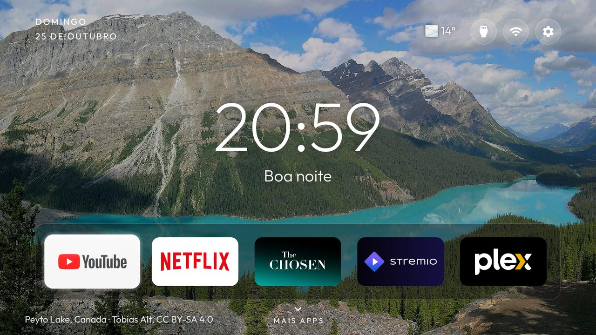

# Weather feed

The outside temperature for one place, for the [Clean Your TV](../../README.md) launcher to show before its
top-right buttons (theme key `weather_temp`). The launcher has no network permission; this small app is the one
that goes online, and the launcher asks it for its last reading. It has no screen or tile of its own.



- **The place** is set in `app/src/main/res/values/options.xml` before building, as latitude and longitude. The
  default is Vila Nova de Gaia, Portugal.
- **Data** comes from [Open-Meteo](https://open-meteo.com/), which needs no account or key: the temperature now,
  the WMO weather code (shown as a symbol: sun or moon, cloud, fog, rain, snow, storm) and whether it is day.
- **When it goes online:** only when the launcher asks and the stored reading is older than 30 minutes
  (`refresh_minutes`), and at most every 5 minutes after a failed try. The launcher asks once a minute while Home
  is on screen, so with the TV in an app or off, nothing runs. No service, no timer, no start at boot.
- Degrees Celsius, rounded to whole degrees by the launcher.

## Options

Set in `app/src/main/res/values/options.xml` before building.

| Option | Default | What it does |
|---|---|---|
| `latitude` | `41.124` | The place, in decimal degrees (north positive). |
| `longitude` | `-8.612` | The place, in decimal degrees (east positive). |
| `refresh_minutes` | `30` | How old a reading may be before the next request from the launcher fetches a new one. |

## Permissions

| Permission | Why |
|---|---|
| `INTERNET` | Open-Meteo, for the temperature at the place above. |

That is all. What is sent: the latitude and longitude in `options.xml`. No account, no telemetry, no location
permission. The last reading stays in the app's own storage (backups are off). Its provider
(`content://com.gathin.weatherfeed/current`) is read-only and answers any app with that reading.

## Build and install

JDK 17 and Android SDK platform 34 with build-tools 34.0.0, as for the launcher:

```bash
cd addons/weather-feed && ./gradlew assembleRelease
TV_HOST=<tv ip> ../../tools/venv/bin/python -I ../../tools/b64push.py app/build/outputs/apk/release/app-release.apk /data/local/tmp/addon.apk
TV_HOST=<tv ip> ../../tools/venv/bin/python -I ../../tools/tv.py 'pm install -r /data/local/tmp/addon.apk; rm -f /data/local/tmp/addon.apk'
```

Then set `"weather_temp": true` in your theme's `config.json` (as `themes/nature` does) and push it. The
temperature shows within a minute of Home coming up. To check the app on its own:
`tools/tv.py 'content query --uri content://com.gathin.weatherfeed/current'`.

The release build is signed with the debug key so it installs over ADB like the launcher.

## Tested on

Xiaomi TV A Pro 2026 (MiTV-MZTU0), Google TV 14 / Android 14: the reading through `content query`, and the
temperature with its symbol in the launcher's top bar.

## Maintainer

Guilherme Coelho
